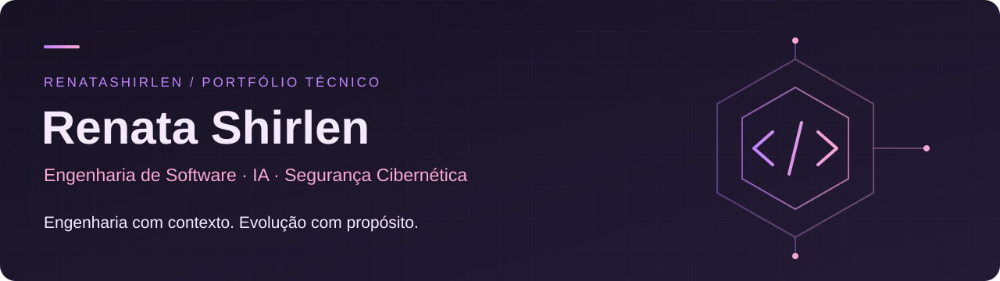

  

# Olá, eu sou a Renata

**Engenharia de Software · Desenvolvimento com IA · Segurança Cibernética**

[Sobre mim](#sobre-mim) · [Projetos em destaque](#projetos-em-destaque) · [Stack](#tecnologias-e-ferramentas) · [Formação](#formação) · [Credenciais](#certificações-e-credenciais) · [Contato](#contato)

## Sobre mim

Desenvolvo e evoluo sistemas, do legado Java às aplicações web modernas, com atenção às regras de negócio, à manutenção e à segurança. Exploro IA como apoio à engenharia, com revisão humana e validação das mudanças. Curso o mestrado em Segurança Cibernética na Universidade de Brasília (UnB).

## Projetos em destaque

### Engineering Activity · público

Painel de atividade de engenharia alimentado por um pipeline Python sem dependências externas de execução. Transforma o histórico de trabalho em contagens mensais de commits, dias ativos, versões e issues fechadas, preservando informações institucionais. O card abaixo é gerado da mesma fonte do painel e informa os períodos e a data do snapshot.

[Painel ao vivo →](https://renatashirlen.github.io/engineering-activity/) · [Código e metodologia →](https://github.com/renatashirlen/engineering-activity)

### Portal RSC · experiência institucional privada

Atuação na evolução de uma aplicação para o Reconhecimento de Saberes e Competências na UnB. Stack moderna com **Java 21, Spring Boot 3, Angular 21 e PostgreSQL**, migrações com **Flyway**, testes com **Testcontainers e Playwright** e integração contínua (**CI**).

Esta apresentação se limita ao contexto e às tecnologias: código, dados e detalhes internos permanecem privados.

## Tecnologias e ferramentas

| Frente | Stack | Aplicação |
| :--- | :--- | :--- |
| Legado | Java 6/7 · JSF · JBoss · Gradle 4 | Sustentação e evolução de sistemas |
| Moderno | Java 21 · Spring Boot 3 · Angular 21 · PostgreSQL | Aplicações web e regras de negócio |
| Qualidade e entrega | Flyway · Testcontainers · Playwright · Git · CI | Migrações, testes e mudanças verificáveis |
| IA | Claude · Codex · MCP · OpenRouter | Assistência ao desenvolvimento e experimentação |
| Dados | SQL · Python | Análise e agregação de indicadores |

## Prática de engenharia

Compreender o problema e suas restrições, planejar mudanças revisáveis, testar o comportamento e documentar decisões. As sugestões de IA passam pela mesma avaliação crítica; a responsabilidade técnica continua humana.

## Formação

- **Mestrado em Segurança Cibernética — Universidade de Brasília (UnB)** · em andamento.
- **Pós-graduação em Banco de Dados** · concluída.
- **Análise e Desenvolvimento de Sistemas** · graduação concluída.
- **Ciência da Computação** · em formação.

## Certificações e credenciais

  
  
  

- **[AWS Certified Cloud Practitioner](https://www.credly.com/badges/df09e3f8-e429-40ed-9155-1e100603a07f/public_url)** — Amazon Web Services Training and Certification · emitida em 20/03/2025 · validade até 20/03/2028.
- **[AWS re/Start Graduate](https://www.credly.com/badges/de9d0005-a4ad-4648-a217-398b08e1a189/public_url)** — Amazon Web Services Training and Certification · conclusão do programa AWS re/Start · emitida em 30/05/2025.
- **[Cybersecurity Essentials](https://www.credly.com/badges/6e84b067-9eb6-48aa-8e90-122c79da33b5/public_url)** — Cisco · conclusão do curso · emitida em 06/10/2023.

## Contato

Vamos conversar sobre engenharia de software, evolução de sistemas, IA e segurança.

**[LinkedIn](https://www.linkedin.com/in/renatashirlen/)** · **[GitHub](https://github.com/renatashirlen)**
